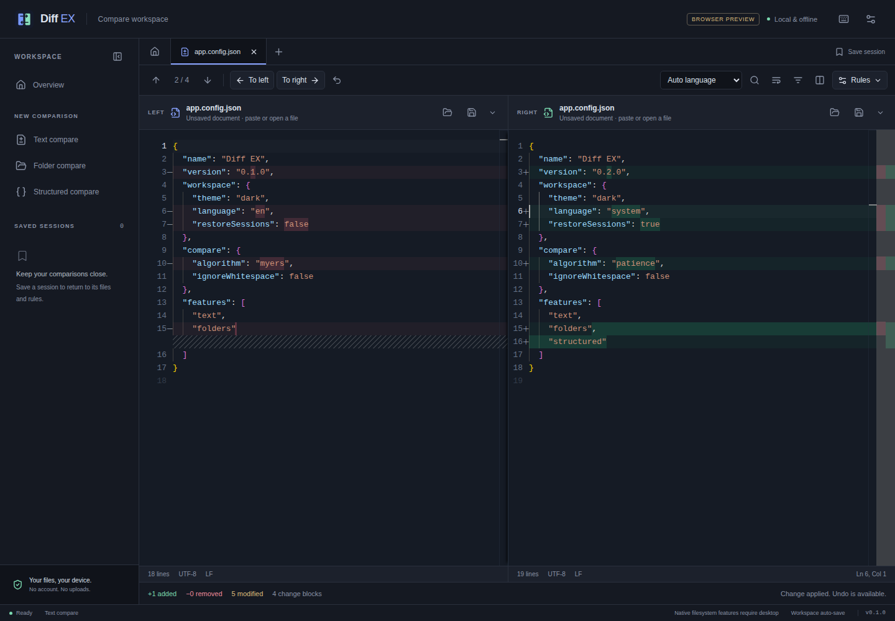
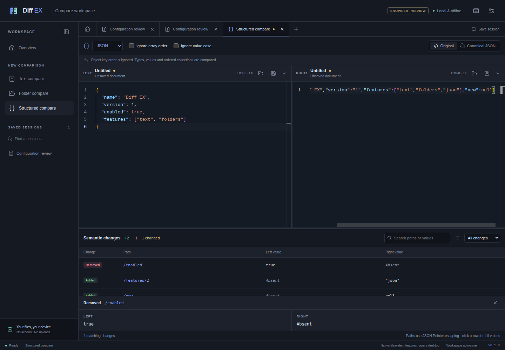

<div align="center">
  
  <h1>Diff EX</h1>
  <p>A local workspace for comparing files, understanding changes, and merging with confidence.</p>
  <p><strong>English</strong> · <a href="README.zh-CN.md">简体中文</a></p>
</div>

[](https://github.com/xzcode/diff-ex/actions/workflows/ci.yml)
[](LICENSE)

**Diff EX is an offline desktop comparison and merge tool for Windows, macOS and Linux.** It combines an editable two-pane workspace with an independent Rust comparison engine. No account, server, telemetry or file upload is needed.

> **Status: initial development baseline, v0.1.0.** The M0 foundation and the first working M1–M3 feature set are implemented. This is not a claim that every item in the long-term Beyond Compare replacement plan is complete. See the [roadmap](docs/ROADMAP.md) and [handoff](docs/HANDOFF_2026-11-27.md) for precise status and verification evidence.

## What works

| Workspace | Implemented behavior |
| --- | --- |
| Text and code | Editable side-by-side / inline diff, syntax highlighting, character-level visual differences, change navigation, two-way hunk merge, copy all, undo, find and folding unchanged regions |
| Comparison rules | Native Myers, Patience and Histogram; ignore case, trim/all whitespace, blank lines, line-ending style, line prefixes and native regex matching |
| Files | UTF-8, UTF-16LE/BE, GBK and GB18030; BOM and line-ending choices; stale-file detection; atomic save; Save As with an existing-target check |
| Folders | Recursive content-hash or size/time comparison; `.gitignore`, custom exclusions, hidden files, status/path filtering, sorting, virtualized rows, possible moves based on unique matching content hashes, and opening a file pair |
| Synchronization | Left/right updates, left/right mirrors and conservative two-way updates; full preview; cancellation; preflight revalidation; backups before overwrite/delete |
| Structured data | JSON, YAML and XML semantic comparison; escaped paths, value/type changes, searchable virtualized results, precise errors, read-only canonical JSON and source-preserving JSON node merge with undo |
| Workspace | Multiple tabs, undo retained while switching tabs, named session snapshots, restoration of drafts/rules/settings, recoverable workspace snapshots |
| Appearance | Pure black, gray, white, soft white and the original midnight theme; 12 interface languages with system detection; configurable font and word wrapping |

**Rules affect the comparison result; the editor shows original text.** Hunk merge always copies original text. A whitespace or case option never silently rewrites a file. Canonical JSON is a read-only comparison representation and is never saved as if it were the original YAML or XML.

Two-way synchronization copies files that exist on only one side. Files modified on both sides remain explicit conflicts because the initial version has no historical synchronization baseline. Symbolic links, special files and file/directory type conflicts are not followed or automatically replaced.

## Themes and languages

Choose **Settings → Appearance** for Pure black, Graphite (gray), White, Soft light (warm white), or Midnight. All surfaces and the editor follow the selected palette, with distinct tabs, sidebars, controls and diff highlights. Language selection applies immediately and persists across launches. Supported app interface languages: English, Simplified Chinese, Traditional Chinese, Japanese, Korean, German, French, Spanish, Brazilian Portuguese, Russian, Malay and Indonesian. The app uses bundled offline translations; native OS dialogs and third-party editor/engine diagnostics may retain their own language. See [appearance and localization](docs/APPEARANCE_I18N.md).

## Screenshots

The screenshots below show the original v0.1.0 production browser preview before the appearance refresh. New theme captures are generated by the updated UI verification workflow. Desktop builds use the same interface and add native filesystem and Rust engines.





[Overview](docs/screenshots/overview.png) · [Soft light theme in Simplified Chinese](docs/screenshots/light-chinese.png)

## Get and build

Open a successful `master` run of the [desktop workflow](https://github.com/xzcode/diff-ex/actions/workflows/ci.yml), then download the matching item under **Artifacts**. GitHub requires signing in to download workflow artifacts.

| Platform | Artifact | Contents |
| --- | --- | --- |
| Windows x64 | `diff-ex-windows-x64` | NSIS `.exe` installer and `.msi` |
| macOS Intel / Apple Silicon | `diff-ex-macos-universal` | Universal `.dmg` and zipped `.app` |
| Linux x64 | `diff-ex-linux-x64` | `.deb` and `.AppImage` |

These are development builds. Tagged builds publish to [Releases](https://github.com/xzcode/diff-ex/releases) after verification and all platform builds succeed. [The handoff](docs/HANDOFF_2026-11-27.md) records the builds and checks actually completed.

### Prerequisites

- Node.js 24 and npm.
- Current stable Rust and Cargo.
- [Tauri platform prerequisites](https://v2.tauri.app/start/prerequisites/): C++ Build Tools/WebView2 on Windows, Xcode command-line tools on macOS, GTK/WebKitGTK development packages on Linux.

```bash
npm ci
npm run desktop:dev
```

Build an installer on the current operating system:

```bash
npm run desktop:build
```

The macOS configuration uses an ad-hoc signature. It is not an Apple Developer ID signature or notarization. Windows packages are not code-signed in this initial repository configuration.

### Browser preview

```bash
npm ci
npm run dev
```

Open `http://localhost:1420`. The preview supports local text selection, editing, Myers comparison, JSON semantic comparison and downloading UTF-8 text. It explicitly reports that native filesystem synchronization, Patience/Histogram, regex filtering, YAML/XML semantic engines and non-UTF-8 saving require the desktop app. The preview does not simulate successful native operations.

## Everyday workflow

1. Create a text, folder or structured comparison from the overview.
2. Open or drop files, or paste content into either editor. Desktop files with a BOM are detected automatically; the file menu also offers explicit encoded opening.
3. Navigate differences and apply selected original-text hunks in either direction. Undo remains available when switching tabs.
4. Save a side explicitly. If the file changed on disk since it was opened, saving stops instead of overwriting the newer version.
5. For folders, compare first, choose a sync mode, review the complete preview, then apply it. Overwrites and deletions retain backups; errors and cancellation show partial results.
6. Save a named session for a reusable snapshot. Open tabs, unsaved drafts, comparison options and preferences also restore on restart.

Keyboard: `Ctrl/Cmd+N` new text comparison, `Ctrl/Cmd+O` open, `Ctrl/Cmd+S` save the focused pane, `Ctrl/Cmd+Shift+S` Save As, `F7` / `Shift+F7` differences, `Ctrl/Cmd+F` find, `Ctrl/Cmd+Z` undo, `Ctrl/Cmd+,` settings.

## Verification

```bash
npm run check
npm test
npm run build
cargo fmt --all -- --check
cargo test --locked -p diff-ex-core
cargo check --locked -p diff-ex
```

Production UI smoke tests (real Chromium, screenshots and report):

```bash
npx playwright install --with-deps chromium
npm run build
npm run test:ui
```

The tests target merge coordinates/line endings, exact JSON numbers, duplicate keys, YAML precision rejection, XML ordering, filesystem safety, stale sync plans, metadata-only drafts and persistence. CI stores screenshots as `ui-verification`; it does not use mock filesystem synchronization.

## Architecture and scope

- `src/`: Vue 3, TypeScript and Monaco; workers bundled locally, no editor CDN.
- `crates/diff-core/`: independent Rust text, structured, encoding, directory and synchronization engines.
- `src-tauri/`: native commands, cancellation, trusted plan storage and atomic workspace persistence.
- `docs/`: [product specification](docs/PRD.md), [architecture](docs/ARCHITECTURE.md), [formats and safety](docs/SAFETY_AND_FORMATS.md), [roadmap](docs/ROADMAP.md).

There are no arbitrary limits on tabs, saved sessions, file counts or file sizes. Text editing and exact text comparison still load content into memory; directory hashing streams file bytes. Large-file paging and a fully interruptible text-diff engine are future work. Synchronization is atomic per file, not a transaction over an entire directory tree. See the format document for preserved metadata and recovery behavior.

Binary/image/spreadsheet comparison, three-way merge, archive/remote/Git integrations, office documents, databases and a CLI remain planned.

## License

[Apache License 2.0](LICENSE). Third-party dependencies retain their respective licenses. See [THIRD_PARTY.md](THIRD_PARTY.md) for the main components and the lockfiles for exact versions.
