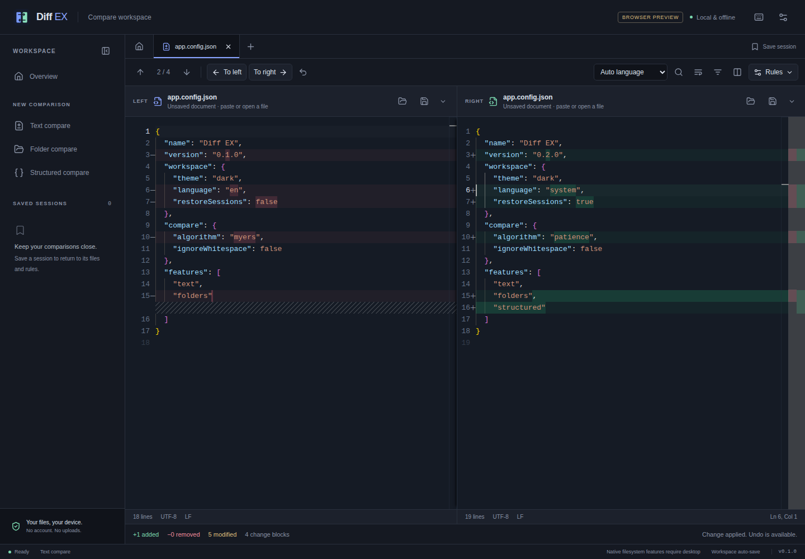
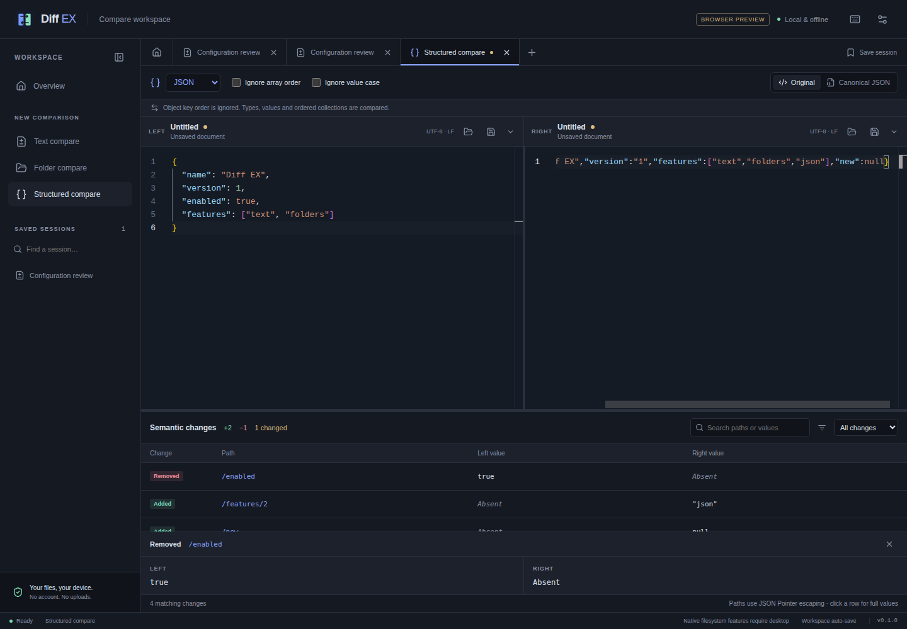

<div align="center">
  
  <h1>Diff EX</h1>
  <p>比较文件，理解差异，自由合并。</p>
  <p><a href="README.md">English</a> · <strong>简体中文</strong></p>
</div>

[](https://github.com/xzcode/diff-ex/actions/workflows/ci.yml)
[](LICENSE)

**Diff EX 是 EX 系列的本地离线桌面对比与合并工具，目标平台为 Windows、macOS、Linux。** 界面采用 Vue 3 + Monaco，原生文件操作和对比引擎使用 Rust，通过 Tauri 2 连接。无需注册、服务端或上传文件，没有遥测。

> **当前状态：v0.1.0 开发基线。** M0 工程基础与 M1–M9 首版核心功能已落地，新增 Git/SFTP 和文档比较。；最初规划的完整专业工具功能仍按阶段推进。具体已完成和未完成范围见[阶段计划](docs/ROADMAP.md)及[交接记录](docs/HANDOFF_2026-11-27.md)。

## 已实现

| 模块 | 当前功能 |
| --- | --- |
| 文本与代码 | 左右均可编辑，双栏/单栏，语法高亮，行内字符差异，差异导航，按块双向合并，整侧复制，撤销、查找、折叠相同行 |
| 比较规则 | 原生 Myers / Patience / Histogram，忽略大小写、首尾/全部空白、空行、换行风格、行前缀及桌面版正则过滤 |
| 文件打开与保存 | UTF-8、UTF-16LE/BE、GBK、GB18030，BOM 与换行设置，磁盘变更检查，原子写入，另存为覆盖确认 |
| 目录比较 | 递归内容哈希/大小时间比较，`.gitignore`、自定义排除、隐藏文件，状态/路径筛选、排序、虚拟列表、按唯一内容哈希识别可能的重命名/移动、双击打开文件对 |
| 目录同步 | 双向更新、左右单向更新、左右镜像，完整操作预览、取消、执行前复查、覆盖/删除备份、部分执行结果 |
| 结构化比较 | JSON / YAML / XML，字段顺序处理、类型变化、节点路径、搜索筛选、完整值详情、解析错误、只读规范化 JSON、保留原文的 JSON 节点双向合并与撤销 |
| 工作区 | 多标签，切换标签保留撤销历史，命名会话快照，自动恢复未保存编辑和规则，异常工作区恢复/备份 |
| 外观与语言 | 纯黑、灰色、白色、柔和白色及原有深色主题，12 种界面语言和跟随系统，字号与自动换行设置 |

比较规则只影响结果判断，编辑器显示原文差异，合并复制原始内容。规范化 JSON 只是只读的比较表示，不会把 YAML/XML 的规范化结果当成原文件格式保存。

双向同步对单侧文件进行补齐；两侧同名文件内容不同会保留为冲突，不猜测覆盖方向。首版没有历史同步基线，不能自动判定哪一侧是用户希望保留的新版本。符号链接、特殊文件以及文件/目录类型冲突不会自动跟随或替换。

## 主题与语言

在 **设置 → 外观主题** 中可选择纯黑、灰色、白色、柔和白色和原有深色主题。编辑器、侧栏、标签、工具栏、表格、对话框及差异颜色采用对应配色。语言可即时切换并在重启后恢复：英文、简体中文、繁体中文、日语、韩语、德语、法语、西班牙语、巴西葡萄牙语、俄语、马来语、印度尼西亚语。翻译资源随应用离线分发；系统原生对话框、第三方编辑器内置菜单及底层诊断可能保留自身语言。详情见[主题与国际化](docs/APPEARANCE_I18N.md)。

## 二进制、图片及表格比较

| 工作区 | 功能 |
|---|---|
| 二进制 | 按偏移量逐字节比较、分页十六进制及 ASCII、全文件流式扫描、首末差异跳转、取消扫描 |
| 图片 | 解码后的栅格像素、双栏、透明叠加、分割视图、差异热图、通道容差及尺寸差异计数 |
| 表格 | CSV/TSV 分隔符及编码设置；桌面版 XLS/XLSX/XLSM/XLSB/ODS 工作表读取；列名对齐、主键匹配、单元格详情及分页 |

新增工作区当前为只读。二进制不推断插入删除对齐；图片比较解码后的第一帧，不比较元数据或动画；表格比较已读取的单元格值，不比较格式、不执行宏或重新计算公式。Excel/OpenDocument 需桌面版。浏览器会话恢复后需要重新选择文件；工作区快照不会复制这些文件的源数据。

## 三方合并及压缩包比较

- 三方文本合并：加载或粘贴共同基础版本、左侧版本及右侧版本，独立或相同修改自动合并；冲突可选择基础/左侧/右侧或手动编辑。所有冲突解决后可编辑并保存独立结果文件。修改源内容会使旧结果失效，原生保存拒绝将任意源文件或同一文件的别名作为目标。
- 压缩包比较：ZIP（包括 JAR/APK/WAR）、7z、TAR、TAR.GZ/TGZ 及 GZIP。流式读取解压内容并计算 BLAKE3 哈希，虚拟路径支持跨格式对比、状态筛选、分页、条目详情和取消，不提取或执行文件。加密压缩包和不支持的算法会报错；普通 GZIP 流作为单个虚拟 payload 比较。压缩包比较需要桌面版。

三方合并为逐行保守冲突策略。三方目录合并、二进制编辑、压缩包成员提取/回写、密码输入尚未实现。

## Git、SFTP 与文档比较

- Git：比较分支、标签、提交/树 ID 与工作区，支持跨仓库；使用 libgit2 固定版本树，不检出、不拉取、不执行钩子/外部 diff、不写入仓库。可打开独立文本副本。
- SFTP：比较本地/远程文件或目录，按内容哈希匹配；支持保存连接、密码/私钥/Agent 认证、强制独立核实 SHA256 主机指纹、取消扫描及打开独立文本副本。密码和口令不持久化，不跟随链接或特殊文件，不执行远程命令、不写入远程。
- DOCX/DOCM：提取段落、表格、页眉页脚、注释和脚注等文字及包结构、属性签名；PDF：提取页面文本、页面尺寸和结构签名。无法提取内容明确标为不可用。旧 DOC 文本需可选本地 antiword；PDF 页面像素对比需可选本地 Poppler 的 pdftoppm（PATH 中），安装包不内置这些工具。Word 版式为结构属性比较，不是完整的 Word 页面渲染。

Git/SFTP/文档提取需要桌面版。主动打开的独立文本副本可以被本地工作区自动保存。Git 暂存区单独比较、重命名对齐、远程同步写入、Word 页面真实渲染、OCR、加密文档支持尚待完善。

## 界面截图

以下为外观更新之前 v0.1.0 开发基线的生产版浏览器预览实图。新版主题截图由更新后的 UI 验证工作流生成。桌面版使用相同界面，并提供原生文件操作与 Rust 引擎。





[首页](docs/screenshots/overview.png) · [柔和浅色主题与简体中文](docs/screenshots/light-chinese.png)

## 获取安装包

打开 [GitHub Actions](https://github.com/xzcode/diff-ex/actions/workflows/ci.yml) 中成功完成的 `master` 构建，在页面的 **Artifacts** 区域下载对应平台的产物。下载工作流产物需要登录 GitHub。

| 平台 | 产物名称 | 包含文件 |
| --- | --- | --- |
| Windows x64 | `diff-ex-windows-x64` | NSIS `.exe` 安装程序、`.msi` |
| macOS Intel / Apple Silicon | `diff-ex-macos-universal` | 通用架构 `.dmg`、打包后的 `.app` |
| Linux x64 | `diff-ex-linux-x64` | `.deb`、`.AppImage` |

当前提供开发构建；版本标签触发的构建在验证及三平台打包全部成功后发布到 [Releases](https://github.com/xzcode/diff-ex/releases)。实际构建和验证记录见[交接文档](docs/HANDOFF_2026-11-27.md)。

## 开发与构建

需要 Node.js 24、当前稳定版 Rust，以及对应平台的 [Tauri 编译依赖](https://v2.tauri.app/start/prerequisites/)。

```bash
npm ci
npm run desktop:dev
```

生成本机安装包：

```bash
npm run desktop:build
```

macOS 配置 Ad-hoc 签名，尚未配置 Apple Developer ID 与公证；Windows 首版未配置代码签名。

浏览器预览：

```bash
npm run dev
```

访问 `http://localhost:1420`。浏览器支持文本打开/编辑、Myers、JSON 结构化比较与 UTF-8 下载；目录访问和同步、Patience/Histogram、YAML/XML 语义引擎以及其他编码保存由桌面版提供。界面明确提示这些边界，不伪造原生操作结果。

## 使用方式

1. 首页新建文本、目录或结构化对比。
2. 打开/拖入文件，或直接粘贴内容。普通打开自动识别 BOM/UTF-8；GBK 等可在文件菜单中指定编码打开。
3. 跳转差异、按块向左/右合并；原始文件仅在点击保存时写入。
4. 保存前检查文件指纹。外部修改导致指纹变化时拒绝覆盖，保留编辑内容供处理。
5. 目录同步先选择方向、查看操作预览，再执行；覆盖和删除会保留备份，取消/失败会说明已完成项目。
6. 命名会话保存文件内容、草稿和比较规则。普通工作区也会自动恢复，数量不设人为上限。

快捷键：`Ctrl/Cmd+N` 新建，`Ctrl/Cmd+O` 打开，`Ctrl/Cmd+S` 保存当前编辑侧，`Ctrl/Cmd+Shift+S` 另存为，`F7 / Shift+F7` 跳转差异，`Ctrl/Cmd+F` 查找，`Ctrl/Cmd+Z` 撤销，`Ctrl/Cmd+,` 设置。

## 验证与文档

```bash
npm run check
npm test
npm run build
cargo fmt --all -- --check
cargo test --locked -p diff-ex-core
cargo check --locked -p diff-ex
```

真实浏览器验证使用 `npx playwright install --with-deps chromium` 和 `npm run test:ui`，输出截图及结果。需要允许启动 Chromium 的运行环境。

- [产品需求](docs/PRD.md)
- [技术架构](docs/ARCHITECTURE.md)
- [格式支持与文件安全边界](docs/SAFETY_AND_FORMATS.md)
- [阶段计划](docs/ROADMAP.md)
- [当前交接记录](docs/HANDOFF_2026-11-27.md)

当前文本编辑和精确文本比较会将内容加载到内存，目录哈希采用流式读取。不设置任意文件数量/大小限制，但分页编辑和可随时中断的大文件文本引擎仍待实现。同步按单个文件原子替换，不提供整个目录事务回滚。

二进制、图片、表格、三方合并、压缩包、Git、远程文件、Office 文档、数据库与 CLI 仍在后续计划。

## 许可证

[Apache License 2.0](LICENSE)。第三方组件保留各自许可证，见 [THIRD_PARTY.md](THIRD_PARTY.md)。
